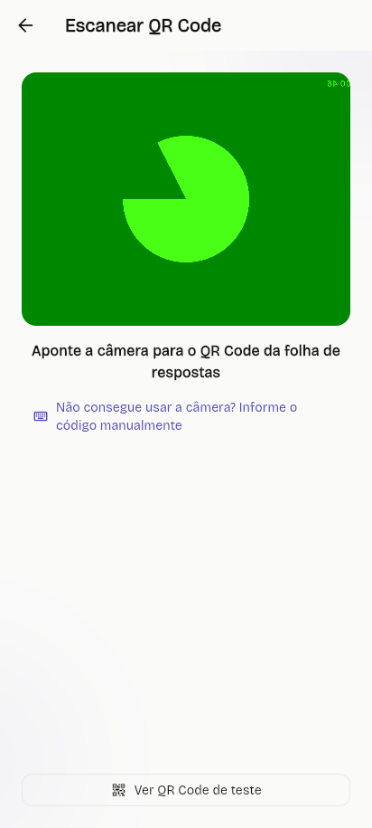
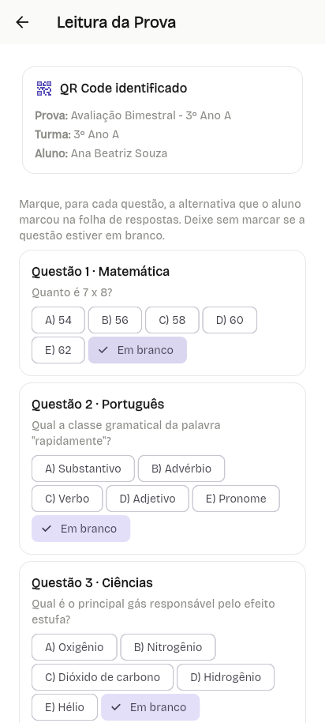
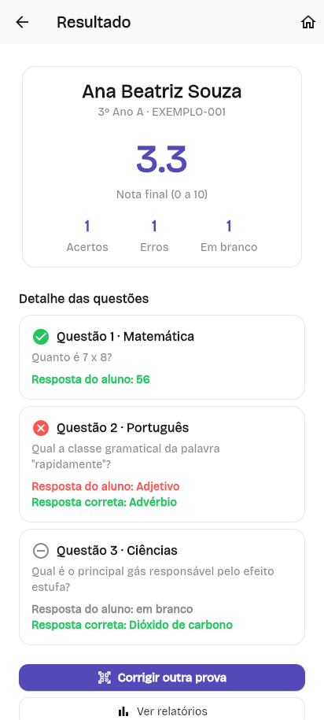
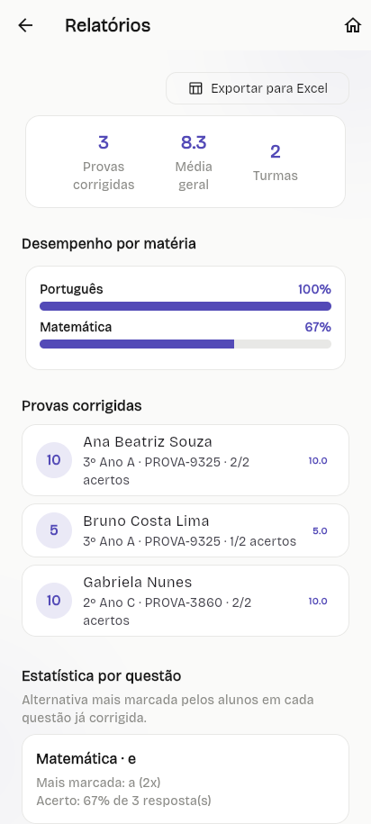

<div align="center">

# 🚀 Provas App

**Sistema para professores criarem, gerarem e corrigirem provas de forma automatizada.**


</div>

## 👥 Equipe

| Nome completo |
|---|
| Laura Meier |
| Tiago Spezia |
| Nicolas Dellani |
| Henrique Roberti Ribeiro |
| Phelipe Gonçalves Blanco |

## 📑 Sumário

- [1. Visão Geral](#1-visão-geral)
- [2. Requisitos](#2-requisitos)
  - [2.1 Funcionais (RF)](#21-funcionais-rf)
  - [2.2 Não Funcionais (RNF)](#22-não-funcionais-rnf)
- [3. Telas do Sistema](#3-telas-do-sistema)
- [4. Modelo de Dados](#4-modelo-de-dados)
- [5. Stack Tecnológica](#5-stack-tecnológica)
- [6. Estrutura de Pastas](#6-estrutura-de-pastas)
- [7. Como Executar o Projeto](#7-como-executar-o-projeto)
- [8. Backlog de Atividades da N2](#8-backlog-de-atividades-da-n2)

---

## 1. Visão Geral

📌 **N1**

O Provas App é um aplicativo voltado a professores que precisam lidar com grandes volumes de correção de provas. A proposta é reunir, em um único sistema, a criação de questões, a geração de provas e a correção automatizada, hoje feitas em ferramentas separadas ou manualmente.

O principal problema identificado com o cliente é a perda de tempo na correção manual de provas: professores chegam a corrigir de 200 a 400 provas por semana, o que consome tempo que poderia ser usado em outras atividades, além de atrasar a devolução do resultado aos alunos.

O objetivo do app é automatizar esse fluxo, da criação da prova até a correção, tornando o processo mais rápido, organizado e com menos esforço manual para o professor, com uma interface minimalista, simples e fácil de usar.

### Escopo implementado

**Fase N1 (concluída):**
- Telas navegáveis entre si (Home → Turmas → Banco de Questões → Criar Prova → Corrigir Prova → Relatórios);
- Dados fictícios (mock), sem persistência real;
- Padrão visual (cores, tipografia, espaçamentos) aplicado de forma consistente em todas as telas.

**Fase N2 (concluída): integração real com banco de dados**

Nesta fase o app deixou de depender de dados mock nas telas principais e passou a ler e gravar dados no **Firebase** (Authentication e Cloud Firestore).

- **Autenticação real** com Firebase Authentication (e-mail e senha): tela de **Login** com validação e mensagens de erro em português, tela de **Cadastro** (nome, e-mail, senha e confirmação), recuperação de senha por e-mail ("Esqueci minha senha") e controle de sessão (sem usuário logado o app abre no Login; com usuário logado abre direto na Home; botão **Sair** na Home encerra a sessão).
- **Home com números reais**: os contadores de Turmas, Alunos e Provas são lidos do Firestore e atualizados automaticamente.
- **Turmas e Alunos no Firestore**: cadastrar, listar, editar e excluir turmas (a exclusão remove também os alunos da turma), vinculadas ao usuário logado.
- **Banco de Questões no Firestore**: cadastro, edição, exclusão e listagem das questões usadas na geração das provas.
- **Criar Prova no Firestore**: turmas e questões carregadas do banco, validação da configuração, provas gravadas e consultadas no banco, e geração de PDF da prova.
- **Correção de provas no Firestore**: a leitura do QR code da folha de respostas (pela câmera do dispositivo) identifica a prova, o professor marca as respostas e o resultado da correção é salvo na coleção `correcoes`.
- **Relatórios com dados reais**: a tela lê as correções do Firestore em tempo real e exibe provas corrigidas, média geral, total de turmas, desempenho por matéria e estatística por questão (alternativa mais marcada e percentual de acerto).
- **Exportação para Excel** dos resultados corrigidos.
- **Regras de segurança do Firestore**: acesso permitido apenas a usuários autenticados.

**Fora da N2** (previsto para as próximas fases do projeto):
- Restrição de acesso por dono (cada professor ver somente os próprios dados);
- Geração do QR code impresso na folha de respostas (hoje a identificação é lida a partir da prova já salva no banco).

## 2. Requisitos

📌 **N1** (ajustados ao longo das entregas seguintes conforme o escopo evoluiu)

### 2.1 Funcionais (RF)

| Código | Requisito |
|---|---|
| RF01 | Gerar provas automaticamente a partir de um banco de questões |
| RF02 | Cadastrar e organizar um banco de questões |
| RF03 | Randomizar a ordem das questões e alternativas entre provas de uma turma |
| RF04 | Escolher entre usar as mesmas questões para todos ou gerar provas diferentes por aluno |
| RF05 | Gerar folha de respostas separada da prova, com QR code de identificação |
| RF06 | Ler o QR code para identificar a prova/gabarito |
| RF07 | Corrigir automaticamente a prova a partir das alternativas marcadas |
| RF08 | Calcular a nota automaticamente após a correção |
| RF09 | Exibir relatório das avaliações corrigidas |
| RF10 | Exportar resultados em planilha (Excel) |
| RF11 | Gerar estatística por questão (alternativa mais marcada) |
| RF12 | Importar lista de alunos |
| RF13 | Gerar prova individualizada e identificável por aluno |
| RF14 | Editar o layout da prova gerada |
| RF15 | Exigir autenticação (login ou cadastro) para acessar o app; os dados são gravados no banco apenas para usuários autenticados |
| RF16 | Conseguir editar e remover questões, turmas e provas |
| RF17 | Permitir cadastro de novo usuário e recuperação de senha por e-mail |
| RF18 | Exibir na Home a quantidade real de turmas, alunos e provas |

> **Mudança em relação à v1:** o RF15 original previa navegação sem login. Na N2 o app passou a exigir autenticação para abrir, pois os dados ficam no banco e pertencem a um usuário.

### 2.2 Não Funcionais (RNF)

| Código | Requisito |
|---|---|
| RNF01 | Interface minimalista, com poucos elementos na tela |
| RNF02 | Navegação lógica, intuitiva e de fácil uso |
| RNF03 | Correção rápida o suficiente para turmas grandes |
| RNF04 | Leitura confiável das respostas, sem erro de quebra de página |
| RNF05 | Exportação de dados em formato de planilha (Excel) |
| RNF06 | Funcionalidades de escrita/persistência devem exigir usuário autenticado |
| RNF07 | Os dados devem ser persistidos em banco de dados real (Cloud Firestore) |
| RNF08 | Senhas gerenciadas pelo Firebase Authentication, sem armazenamento próprio |
| RNF09 | Mensagens de erro claras e em português |

## 3. Telas do Sistema

📌 **N1**

> Fluxo de navegação: **Login/Cadastro → Home → Turmas / Banco de Questões / Criar Prova / Corrigir Prova / Relatórios**. Abaixo estão as telas do fluxo de Correção de Provas e Relatórios, já na versão integrada ao Firestore (N2); as demais telas (Login, Cadastro, Home, Turmas, Banco de Questões, Criar Prova) ainda precisam dos prints atualizados por quem desenvolveu cada uma.


*Escanear QR Code: leitura real pela câmera do dispositivo (ou entrada manual do código), identificando a prova salva no Firestore.*


*Leitura da prova: o professor marca, questão por questão, a alternativa que o aluno escolheu na folha de respostas.*


*Resultado: nota final calculada automaticamente, com o detalhe de acertos, erros e questões em branco.*


*Relatórios: dados reais lidos do Firestore (média geral, turmas, desempenho por matéria, estatística por questão) e exportação para Excel.*

> 📎 **Pendente:** prints das telas de Login, Cadastro, Home, Turmas, Banco de Questões e Criar Prova — cada responsável pode salvar o print em `docs/telas/` e adicionar aqui no mesmo padrão.

## 4. Modelo de Dados

📌 **N3** (estrutura já em uso desde a N2, incluída aqui como adiantamento)

O Firestore não guarda dados em tabelas com linhas e colunas, ele guarda em coleções de documentos no formato JSON.

```json
// Coleção: turmas
{
  "nome": "3º Ano A",
  "quantidadeAlunos": 25,
  "uid": "a1B2c3D4..."
}
```

| Campo | Tipo | Descrição |
|---|---|---|
| nome | String | Nome da turma |
| quantidadeAlunos | number | Quantidade de alunos cadastrados |
| uid | String | Identificador do professor dono da turma |

```json
// Coleção: turmas/{turmaId}/alunos (subcoleção)
{
  "nome": "Ana Beatriz Souza",
  "matricula": "2024001"
}
```

| Campo | Tipo | Descrição |
|---|---|---|
| nome | String | Nome do aluno |
| matricula | String | Matrícula do aluno |

```json
// Coleção: questoes
{
  "subject": "Matemática",
  "statement": "Quanto é 7 x 8?",
  "alternatives": ["54", "56", "58", "60", "62"],
  "correctIndex": 1
}
```

| Campo | Tipo | Descrição |
|---|---|---|
| subject | String | Matéria da questão |
| statement | String | Enunciado da questão |
| alternatives | Array\<String\> | As 5 alternativas (A a E) |
| correctIndex | number | Índice (0 a 4) da alternativa correta |

```json
// Coleção: provas
{
  "nome": "Avaliação Bimestral",
  "turmaNome": "3º Ano A",
  "mesmaProvaParaTodos": true,
  "totalQuestoes": 10
}
```

| Campo | Tipo | Descrição |
|---|---|---|
| nome | String | Nome da prova |
| turmaNome | String | Turma para a qual a prova foi gerada |
| mesmaProvaParaTodos | boolean | Se todos os alunos recebem a mesma prova ou uma individualizada |
| totalQuestoes | number | Quantidade de questões da prova |

```json
// Coleção: provas/{provaId}/individuais (subcoleção)
{
  "aluno": "Ana Beatriz Souza",
  "questoes": ["..."],
  "gabarito": ["B", "D", "A"]
}
```

| Campo | Tipo | Descrição |
|---|---|---|
| aluno | String | Aluno dono dessa versão da prova (nulo quando é a mesma prova para todos) |
| questoes | Array | Questões já embaralhadas usadas nessa versão da prova |
| gabarito | Array\<String\> | Gabarito (letras) dessa versão da prova |

```json
// Coleção: correcoes
{
  "aluno": "Ana Beatriz Souza",
  "turma": "3º Ano A",
  "provaId": "PROVA-9325",
  "corrigidoEm": "2026-10-20T14:30:00.000",
  "respostas": ["..."]
}
```

| Campo | Tipo | Descrição |
|---|---|---|
| aluno | String | Nome do aluno corrigido |
| turma | String | Turma do aluno |
| provaId | String | Identificador da prova corrigida |
| corrigidoEm | String (ISO 8601) | Data/hora da correção |
| respostas | Array | Cada resposta corrigida (questão, alternativas, índice correto e índice marcado) |

## 5. Stack Tecnológica

📌 **N1** (lista inicial da disciplina, expandida ao longo das entregas seguintes)


- **Flutter**: framework usado para construir a interface e a navegação do app mobile.
- **Dart**: linguagem de programação usada no Flutter.
- **Firebase Core / Cloud Firestore**: banco de dados em nuvem (NoSQL) usado para armazenar e consultar turmas, alunos, questões, provas e correções.
- **Firebase Authentication**: autenticação dos professores (login, cadastro e recuperação de senha).
- **google_fonts**: fontes personalizadas usadas no padrão visual do app.
- **flutter_svg**: renderização dos ícones/ilustrações em SVG das telas.
- **pdf / printing**: geração e impressão/download do PDF da prova gerada.
- **mobile_scanner**: leitura do QR code da folha de respostas pela câmera do dispositivo.
- **qr_flutter**: geração de QR codes (usado no "QR code de teste" da tela de correção).
- **excel**: geração da planilha `.xlsx` exportada na tela de Relatórios.
- **path_provider**: localização da pasta de documentos do app para salvar a planilha exportada (Android/iOS/desktop).

## 6. Estrutura de Pastas

📌 **N1**, atualizada conforme o projeto cresceu

```
lib/
  models/              # entidades do app (Turma, Aluno, Question, ResultadoCorrecao...)
  data/                # acesso a dados auxiliares e cálculos (ex.: relatorios_calculos.dart)
  routes/              # nomes/definições das rotas do app
  screens/             # telas do aplicativo, uma subpasta por área
    correcao/          # fluxo de Corrigir Prova (QR code, leitura, resultado)
    home/               # Home
    login/              # Login e Cadastro
    provas/             # Criar Prova
    questoes/            # Banco de Questões
    relatorios/          # Relatórios
    turmas/               # Turmas e Alunos
  services/            # comunicação com o Firebase (repositórios) e regras do app
  theme/               # cores, tipografia e espaçamentos do app
  utils/               # validadores, geradores e utilitários diversos
  widgets/             # componentes de interface reutilizáveis entre telas
  main.dart            # inicialização do Firebase e ponto de entrada do app
  auth_gate.dart       # mostra Login ou Home conforme a sessão do usuário
docs/
  telas/               # prints das telas do app
  modelo-dados/        # material de apoio do modelo de dados
  backlog/             # material de apoio do backlog de cada entrega
test/
  ...                  # testes automatizados (flutter test)
```

## 7. Como Executar o Projeto

📌 **N1**, revisado a cada entrega

```
1. git clone https://github.com/lauraMeie/Trabalho-Dev.git
2. cd Trabalho-Dev
3. flutter pub get
4. flutter run -d chrome
```

Observações:
- O app já inclui a configuração do Firebase (`lib/firebase_options.dart`). Para usar outro projeto Firebase, rode `flutterfire configure`.
- Para rodar no Android, o app Android precisa estar registrado no projeto Firebase (`flutterfire configure`, marcando a plataforma android).
- Para gerar o APK: `flutter build apk --release`. O arquivo fica em `build/app/outputs/flutter-apk/app-release.apk`.
- Para rodar os testes automatizados: `flutter test`.
- Para verificar a análise estática: `flutter analyze`.

## 8. Backlog de Atividades da N2

📌 **N2**

> Backlog real (o que cada integrante efetivamente fez na N2), com base nos Pull Requests mesclados na branch `main`.

### Laura Meier

| Tarefa | Prazo | Status |
|---|---|---|
| Implementar login com Firebase Authentication | 26/10 | Concluído |
| Criar tela de cadastro de usuário | 26/10 | Concluído |
| Recuperação de senha por e-mail | 26/10 | Concluído |
| Controlar sessão do usuário (AuthGate) e botão Sair | 26/10 | Concluído |
| Contadores reais na Home (Turmas, Alunos, Provas) | 26/10 | Concluído |
| Vincular turmas ao usuário logado (uid) | 26/10 | Concluído |
| Atualizar o README para v2 | 26/10 | Concluído |

### Tiago Spezia

| Tarefa | Prazo | Status |
|---|---|---|
| Implementar leitura real do QR code pela câmera | 27/10 | Concluído |
| Implementar leitura/correção automática real das respostas | 27/10 | Concluído |
| Persistir resultados de correção no Firestore | 27/10 | Concluído |
| Conectar Relatórios aos dados reais do Firestore | 27/10 | Concluído |
| Implementar exportação de notas e resultados em Excel | 27/10 | Concluído |

### Nicolas Dellani

| Tarefa | Prazo | Status |
|---|---|---|
| Integração de Turmas e Alunos com o Firestore (CRUD completo) | 22/10 | Concluído |

### Henrique Roberti Ribeiro

| Tarefa | Prazo | Status |
|---|---|---|
| Conectar a tela Criar Prova às turmas do Firestore | 20/10 | Concluído |
| Validar a configuração da prova antes de gerar | 20/10 | Concluído |
| Tratar erros no fluxo de criação de prova | 20/10 | Concluído |
| Gerar o PDF da prova | 20/10 | Concluído |

### Phelipe Gonçalves Blanco

| Tarefa | Prazo | Status |
|---|---|---|
| Conectar o Banco de Questões ao Firestore | 20/10 | Concluído |
| Ajustar o model Question (toMap/fromMap) | 20/10 | Concluído |
| Implementar edição e exclusão de questões | 20/10 | Concluído |
| Validar o formulário de criar/editar questão | 20/10 | Concluído |
| Tratar erros e estados vazios no Banco de Questões | 20/10 | Concluído |
| Persistir a geração de prova no Firestore | 20/10 | Concluído |
| Remover tela duplicada de Banco de Questões | 20/10 | Concluído |

---

<div align="center">

Link do vídeo das nossas telas: https://youtube.com/shorts/PHKnWtK98DI?feature=share

</div>
