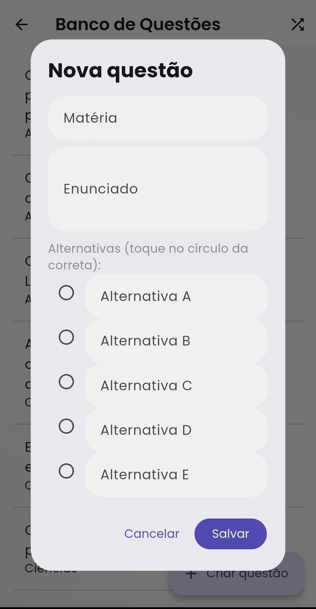

# Manual do usuário: Banco de Questões

> Módulo de **Phelipe Gonçalves Blanco** · [voltar ao índice do manual](README.md)

O Banco de Questões guarda todas as questões de múltipla escolha do professor. É daqui que a tela **Criar Prova** puxa as questões para montar cada prova. Cada questão tem uma matéria, um enunciado, 5 alternativas (A a E) e uma alternativa correta.

Cada professor tem o **seu próprio banco**: as questões que você cadastra ficam ligadas à sua conta e não aparecem para outros professores.

**Antes de começar, você precisa:**
- estar logado no app;
- estar com internet para salvar as alterações.

---

## 1. Abrir o Banco de Questões

Na tela inicial, toque em **Banco de Questões** (também dá para abrir pelo menu lateral).

A lista mostra o **enunciado** de cada questão e, embaixo, a **matéria**. As questões aparecem em ordem de matéria e, dentro de cada matéria, em ordem alfabética do enunciado.

A lista se atualiza sozinha: qualquer questão criada, editada ou excluída aparece na hora, sem precisar recarregar a tela.

### Banco vazio: carregar questões de exemplo

Na primeira vez, o banco está vazio e a tela mostra **"Nenhuma questão cadastrada"**. Você pode:

- tocar em **Criar questão** para cadastrar a primeira; ou
- tocar em **Carregar questões de exemplo** para copiar **50 questões prontas** (10 de cada matéria: Ciências, Geografia, História, Matemática e Português) para a sua conta. É útil para testar o app. Se tocar de novo, as questões não são duplicadas.

---

## 2. Ver as alternativas de uma questão

Toque em uma questão (ou na setinha ao lado) para abrir os detalhes:

- as 5 alternativas, de **A** a **E**;
- um **✓ verde** na alternativa correta;
- os botões **Editar** e **Excluir**.

Toque de novo na questão para fechar.

---

## 3. Criar uma questão

1. Toque no botão **+ Criar questão**, no canto inferior direito.
2. Preencha a **Matéria** (ex.: *Matemática*).
3. Escreva o **Enunciado** da questão.
4. Preencha as **5 alternativas** (A a E).
5. Toque no **círculo** ao lado da alternativa **correta**.
6. Toque em **Salvar**.

Ao salvar, aparece a mensagem **"Questão criada."** e a questão já entra na lista. Para desistir, toque em **Cancelar**: nada é salvo.

> **Dica:** use sempre o mesmo nome para a mesma matéria (por exemplo, sempre *Matemática*, e não às vezes *Mat.*). Na tela **Criar Prova** as questões são filtradas por matéria, e nomes diferentes viram filtros diferentes.

### Regras do formulário

O app só deixa salvar se tudo estiver certo. Quando falta algo, a mensagem aparece em vermelho embaixo do campo:

| Campo | Regra | Mensagem |
|---|---|---|
| Matéria | Obrigatória, com pelo menos 3 letras | *"Informe a matéria."* / *"A matéria precisa ter ao menos 3 letras."* |
| Enunciado | Entre 10 e 500 caracteres | *"Informe o enunciado da questão."* / *"O enunciado precisa ter ao menos 10 caracteres."* |
| Alternativas | As 5 são obrigatórias, com até 200 caracteres cada | *"Preencha esta alternativa."* |
| Alternativas | Não pode haver duas alternativas iguais | *"Já existe outra alternativa igual a esta."* |
| Alternativa correta | Uma precisa estar marcada | *"Marque qual alternativa é a correta."* |

---

## 4. Editar uma questão

1. Toque na questão para abrir os detalhes.
2. Toque em **Editar**.
3. O formulário abre **já preenchido**. Altere o que precisar (inclusive qual é a alternativa correta).
4. Toque em **Salvar**. Aparece a mensagem **"Questão atualizada."**

> **Importante:** editar uma questão no banco **não altera provas já geradas**. Cada prova guarda uma cópia das questões no momento em que foi criada, para que as folhas já impressas continuem batendo com o gabarito. Para corrigir uma questão dentro de uma prova já salva, use **Minhas Provas → Visualizar Prova → Editar questão** (veja a seção [Criar Prova](README.md)).

---

## 5. Excluir uma questão

1. Toque na questão para abrir os detalhes.
2. Toque em **Excluir** (em vermelho).
3. O app mostra o enunciado e pergunta **"Excluir questão?"**.
4. Toque em **Excluir** para confirmar, ou em **Cancelar** para manter a questão.

Ao confirmar, aparece a mensagem **"Questão excluída."**

> A exclusão **não pode ser desfeita**. Assim como na edição, as provas já geradas com essa questão **continuam funcionando** normalmente.

---

## 6. Ver uma prévia de prova gerada

No canto superior direito da tela há o botão **embaralhar** (⤨). Ele mostra um exemplo de como fica uma prova gerada a partir do seu banco:

- escolhe até **5 questões** aleatórias;
- **embaralha** a ordem das questões e das alternativas;
- mostra o **gabarito** de cada questão em verde.

É só uma prévia para conferir as questões: nada é salvo. Para gerar a prova de verdade, use **Criar Prova**.

---

## 7. Usar as questões em uma prova

As questões cadastradas aqui aparecem automaticamente na primeira etapa da tela **Criar Prova**, onde você:

1. filtra por **matéria** (ou vê todas);
2. marca as questões que vão entrar na prova;
3. segue para a configuração da prova.

O passo a passo completo está na seção [Criar Prova](README.md).

---

## Problemas comuns

| Problema | O que fazer |
|---|---|
| A tela mostra **"Não foi possível carregar as questões"** | Verifique a internet e toque em **Tentar novamente**. |
| *"Sem conexão com o servidor. A alteração será enviada quando a internet voltar."* | Você salvou sem internet. A alteração fica guardada no celular e é enviada sozinha quando a conexão voltar. |
| *"Você não tem permissão para fazer isso..."* | Sua sessão pode ter expirado. Saia e entre de novo no app. |
| *"Esse item não existe mais..."* | A questão já tinha sido excluída (por exemplo, em outro celular). A lista se atualiza sozinha. |
| O botão **Salvar** não faz nada | Algum campo tem erro. Role o formulário e veja as mensagens em vermelho. |
| Uma questão não aparece em **Criar Prova** | Confira se ela foi salva (aparece na lista do Banco de Questões) e se o filtro de matéria em Criar Prova está certo. |
| As mesmas matérias aparecem repetidas no filtro de Criar Prova | Os nomes estão escritos de jeitos diferentes. Edite as questões e use o mesmo nome de matéria. |
