# Manual do usuário: Correção de Provas e Relatórios

> Módulo de **Tiago Spezia** · [voltar ao índice do manual](README.md)

Este módulo corrige as provas automaticamente. Você fotografa a folha de respostas do aluno e o app identifica a prova pelo QR Code, lê as alternativas marcadas, calcula a nota e guarda o resultado. Depois, os **Relatórios** mostram o desempenho da turma e permitem exportar as notas para o Excel.

**Antes de começar, você precisa:**
- estar logado no app;
- ter gerado a prova em **Criar Prova** (veja a seção [Criar Prova](README.md));
- ter as **folhas de respostas** impressas e preenchidas pelos alunos.

---

## 1. A folha de respostas

Ao gerar o PDF da prova em **Criar Prova**, cada aluno recebe, depois das questões, uma página **"Folha de respostas"**. É ela que o app lê.

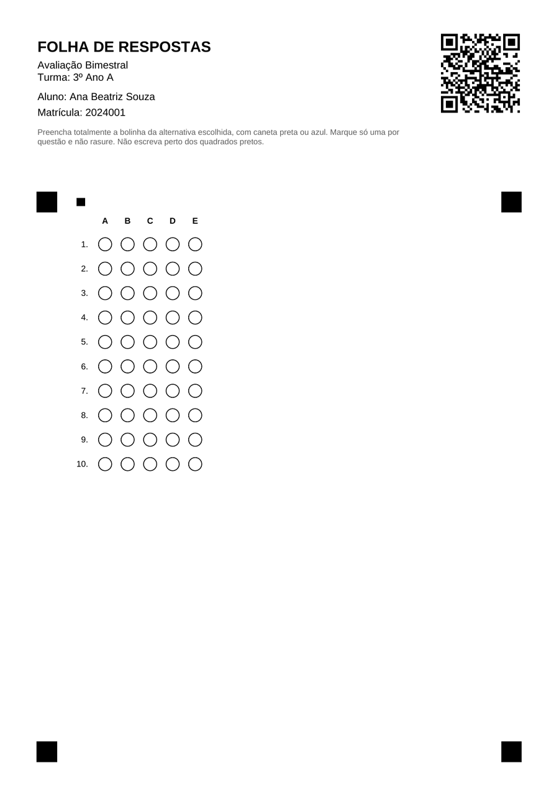

Na folha há:
- **QR Code** (canto superior direito): identifica a prova e o aluno.
- **Bolinhas A–E** para cada questão. Cabem até 60 questões por folha; provas maiores ganham mais de uma folha.
- **4 quadrados pretos** nos cantos e um quadradinho menor: são a referência para a câmera. **Não podem ser cortados, rasurados nem cobertos.**

**Oriente os alunos a:**
1. Preencher **totalmente** a bolinha escolhida, com caneta preta ou azul.
2. Marcar **só uma** alternativa por questão.
3. Não rasurar e não escrever perto dos quadrados pretos.

---

## 2. Abrir a correção

Na tela inicial, toque em **Corrigir Prova**.

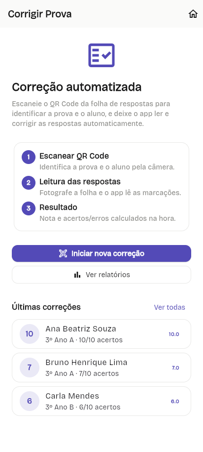

A tela mostra as 3 etapas da correção e as **últimas correções** feitas. Toque em **Iniciar nova correção** para começar.

---

## 3. Escanear o QR Code

1. Aponte a câmera para o **QR Code da folha de respostas**.
2. O app reconhece o código sozinho e busca a prova.

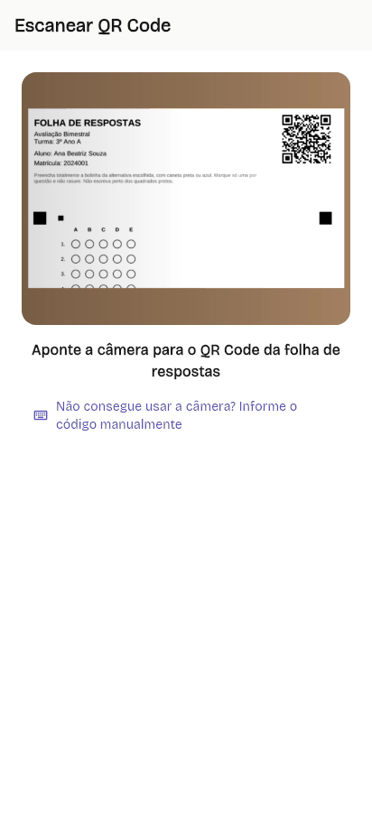 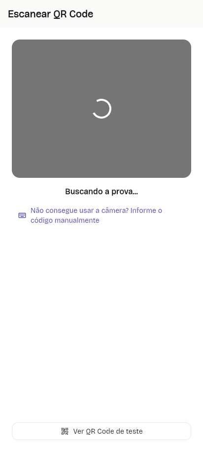

> **Sem câmera?** Toque em **"Não consegue usar a câmera? Informe o código manualmente"**, digite o código do QR Code e toque em **Buscar prova**.

| Mensagem | O que significa |
|---|---|
| *"Esse QR Code não é de uma folha de respostas do Provas App."* | O QR lido é de outra coisa. Aponte para o QR da **folha de respostas**. |
| *"Essa prova não existe mais no banco de dados..."* | A prova foi excluída em **Minhas Provas**. |
| *"Não foi possível buscar a prova. Verifique sua conexão..."* | Sem internet no momento. Tente de novo. |

---

## 4. Ler a folha de respostas pela câmera

Depois do QR Code, abre a tela **Leitura da Prova**, já com a prova, a turma e o aluno identificados.

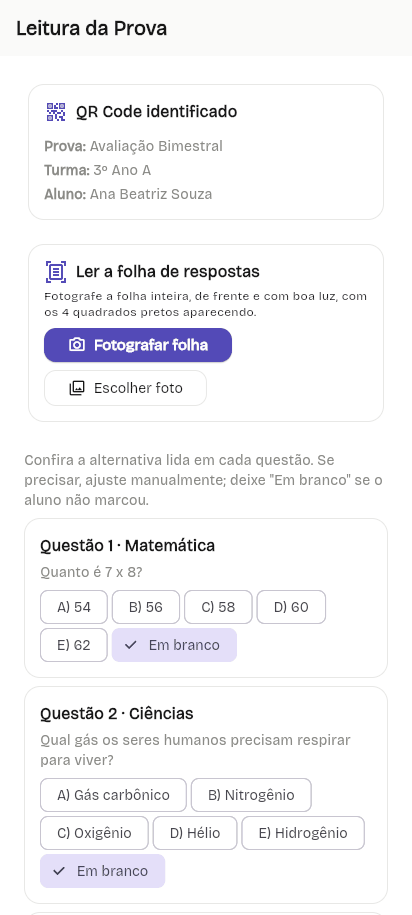

1. Toque em **Fotografar folha**.
2. Fotografe a **folha inteira**, de frente, com os **4 quadrados pretos aparecendo**.
3. Em poucos segundos, o app preenche sozinho a alternativa de cada questão.

> Já tem a foto? Use **Escolher foto** para selecionar uma imagem da galeria.

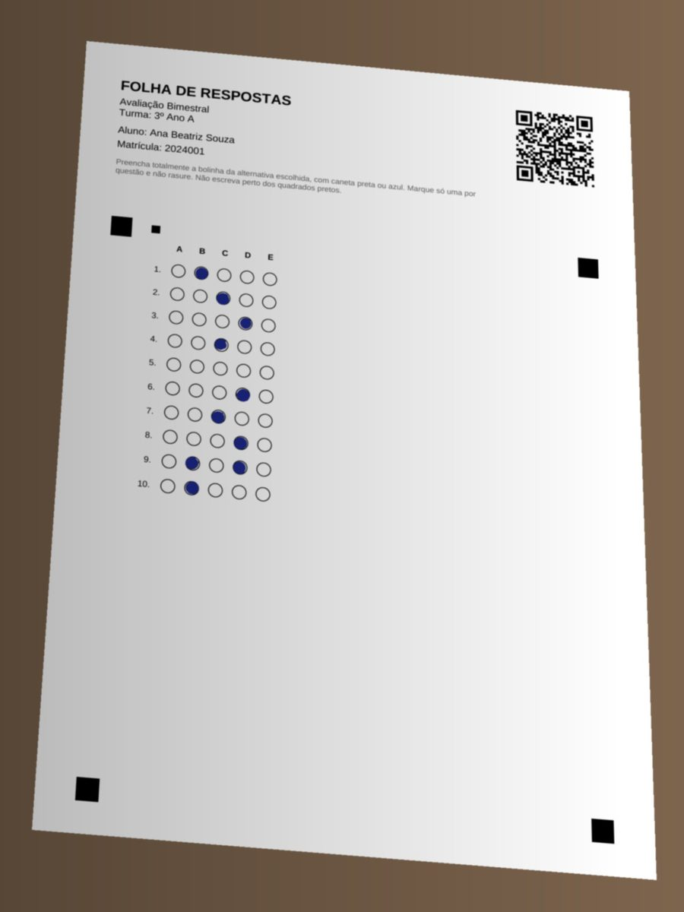 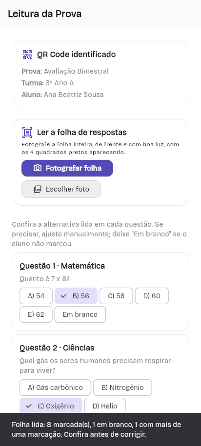

No final da leitura aparece um resumo, por exemplo: *"Folha lida: 8 marcada(s), 1 em branco, 1 com mais de uma marcação. Confira antes de corrigir."*

**Dicas para uma boa foto:**
- Boa luz e sem sombra sobre a folha.
- Folha sobre uma superfície lisa, de preferência mais escura que o papel.
- Não precisa estar perfeitamente reta: o app corrige inclinação e perspectiva, e entende a folha até de cabeça para baixo.

---

## 5. Conferir as respostas

Antes de corrigir, confira as respostas lidas. Você pode tocar em qualquer alternativa para ajustar.

- **Em branco:** questão sem nenhuma bolinha preenchida.
- **Mais de uma marcação:** o app **não escolhe** por você. A questão aparece com um aviso em vermelho; escolha a alternativa válida ou deixe "Em branco" (questão anulada).

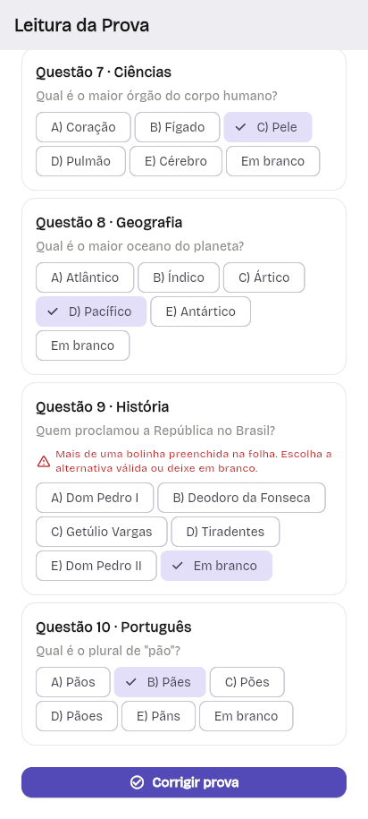

Se preferir, também é possível marcar todas as respostas manualmente, sem foto.

---

## 6. Corrigir e ver o resultado

Toque em **Corrigir prova**. O app compara as respostas com o gabarito daquela prova, calcula a nota (de 0 a 10) e **salva o resultado**.

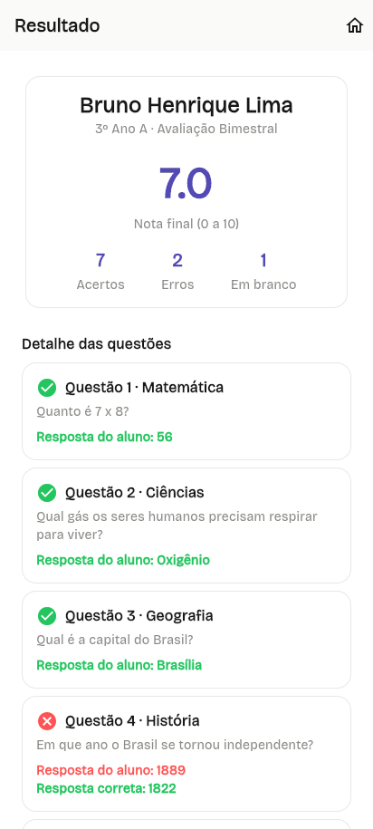

A tela de resultado mostra:
- a **nota final** e o total de **acertos**, **erros** e questões **em branco**;
- o **detalhe de cada questão**: a resposta do aluno (verde se acertou, vermelho se errou) e a resposta correta.

### Corrigir de novo a mesma folha

Cada folha de respostas tem **uma correção só**. Se você corrigir de novo uma folha que já foi corrigida (por exemplo, para ajustar uma resposta lida errado), o app avisa antes de salvar:

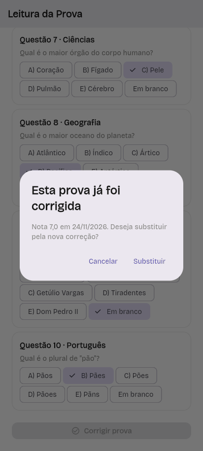

- **Substituir:** a nova correção toma o lugar da anterior. O aluno continua aparecendo uma vez só na lista e nos relatórios.
- **Cancelar:** nada é salvo e a correção anterior continua valendo.

---

## 7. Consultar as provas já corrigidas

Na tela **Corrigir Prova**, toque em **Ver todas**, ao lado de "Últimas correções".

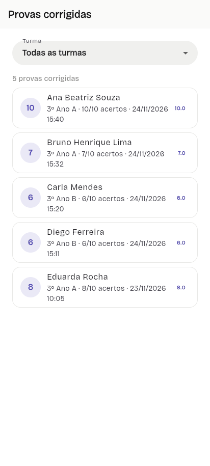

- A lista mostra **todas** as correções, das mais recentes para as mais antigas, com aluno, turma, data e nota.
- Use o campo **Turma** para ver só uma turma.
- Toque numa correção para abrir o resultado completo dela.

---

## 8. Relatórios

Na tela inicial, toque em **Relatórios**, ou em **Ver relatórios** na tela de correção. Os dados se atualizam sozinhos a cada nova correção.

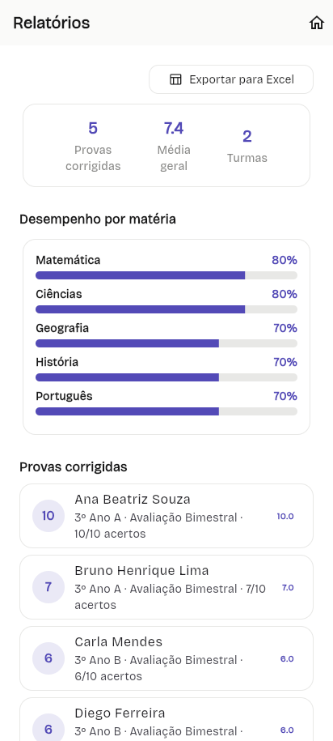 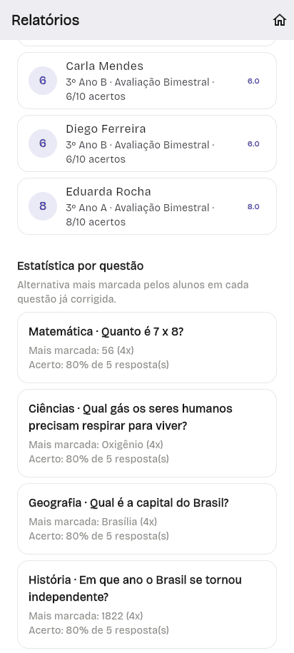

- **Resumo:** total de provas corrigidas, média geral e número de turmas.
- **Desempenho por matéria:** percentual de acerto em cada matéria.
- **Provas corrigidas:** a lista de notas.
- **Estatística por questão:** para cada questão, a **alternativa mais marcada** pelos alunos e o **percentual de acerto**. Ajuda a ver quais conteúdos a turma não entendeu e quais alternativas mais confundiram.

---

## 9. Exportar as notas para o Excel

1. Em **Relatórios**, toque em **Exportar para Excel**.
2. O app gera a planilha `.xlsx` e abre a **janela de compartilhar** do Android.
3. Escolha onde salvar ou para onde enviar: **Google Drive**, **Arquivos**, **WhatsApp**, **e-mail** etc.

A planilha vem pronta para lançar as notas no sistema acadêmico, com estas abas:

| Aba | O que mostra |
|---|---|
| **Resumo** | Uma linha por prova corrigida: aluno, matrícula, turma, prova, nota, acertos, erros, em branco e data da correção. |
| **Uma aba por turma** (ex.: *3 ano a*) | Os alunos da turma nas linhas e as provas nas colunas, com a nota de cada prova e a **média** do aluno. Fica em branco a prova que o aluno ainda não fez. |
| **Respostas** | A alternativa que cada aluno marcou em cada questão (Q1, Q2...): **✓** acertou, **✗** errou, **—** em branco. |

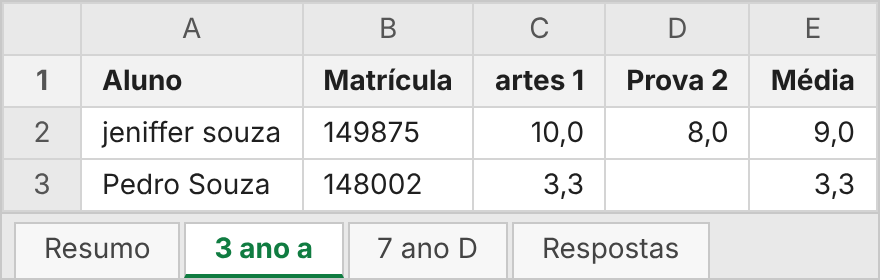

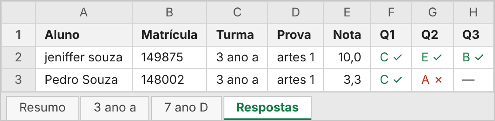

*Exemplo de planilha exportada: aba da turma (alunos × provas, com média) e aba Respostas.*

---

## Problemas comuns

| Mensagem ou situação | O que fazer |
|---|---|
| *"Não encontrei os 4 quadrados pretos dos cantos"* | Enquadre a folha inteira, com boa luz e sobre um fundo mais escuro que o papel. |
| *"A folha ficou muito pequena na foto"* | Aproxime a câmera, de modo que a folha ocupe quase toda a foto. |
| *"Não reconheci esta folha de respostas"* | Use a folha impressa pelo app; folhas de outros modelos não são lidas. |
| Uma resposta foi lida errado | Toque na alternativa certa antes de corrigir. A leitura é sempre conferível. |
| *"Esta prova já foi corrigida"* | A folha já tinha uma correção. Toque em **Substituir** para trocar pela nova ou em **Cancelar** para manter a anterior. |
| Questão com aviso vermelho | O aluno marcou mais de uma bolinha. Escolha a válida ou deixe "Em branco". |
| *"Não foi possível abrir a câmera"* ou *"...acessar a câmera"* | Permita o acesso à câmera nas configurações do celular ou use **Escolher foto** / o código manual. |
| Relatórios vazios | Nenhuma prova foi corrigida ainda com a sua conta. |
