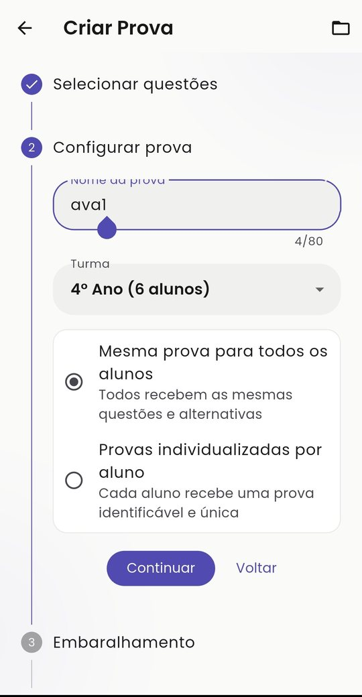
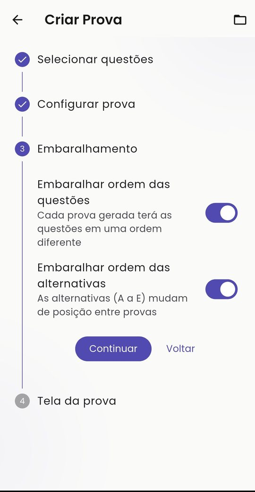
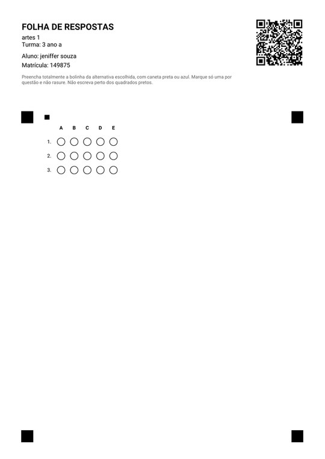
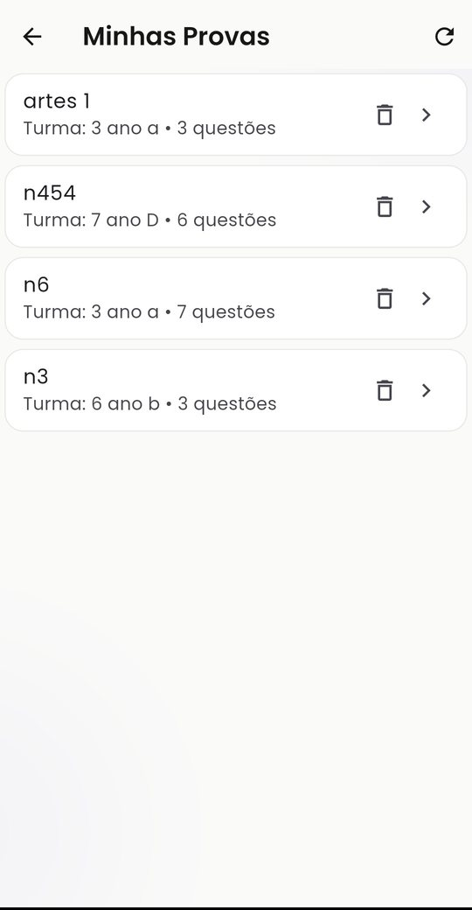
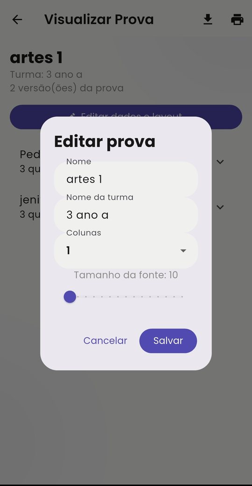

# Manual do usuário: Criar Prova e Minhas Provas

> Módulo de **Henrique Roberti Ribeiro** · [voltar ao índice do manual](README.md)

Este módulo monta as provas. Você escolhe as questões do Banco de Questões, dá um nome à prova, escolhe a turma e decide se todos recebem a mesma prova ou uma prova diferente para cada aluno. O app salva a prova e gera um PDF com as questões e a **folha de respostas** de cada aluno, já com o nome, a matrícula e um QR Code que a correção usa depois. Em **Minhas Provas** você consulta, edita, imprime de novo e exclui as provas já salvas.

**Antes de começar, você precisa:**
- estar logado no app;
- ter questões cadastradas no **Banco de Questões** (veja a seção [Banco de Questões](banco-de-questoes.md));
- ter a turma cadastrada **com os alunos** (veja a seção [Turmas e Alunos](turmas-e-alunos.md));
- estar com internet.

---

## 1. Selecionar as questões

Na tela inicial, toque em **Criar Prova** (também dá para abrir pelo menu lateral). A criação da prova tem 4 etapas: **Selecionar questões**, **Configurar prova**, **Embaralhamento** e **Tela da prova**.

1. A lista mostra as questões do seu Banco de Questões, cada uma com a matéria embaixo.
2. Para ver só uma matéria, toque no nome dela (por exemplo, **Matemática**). Para ver todas de novo, toque em **Todas**.
3. Marque a caixinha ao lado de cada questão que vai entrar na prova. O total aparece no topo, por exemplo *"3 questão(ões) selecionada(s)"*.
4. Toque em **Continuar**.

> As questões marcadas continuam marcadas quando você troca de matéria no filtro. Assim dá para montar uma prova com questões de várias matérias.

Se o banco estiver vazio, aparece *"O Banco de Questões está vazio. Cadastre questões no Banco de Questões antes de criar uma prova."* Cadastre as questões e toque em **Atualizar**.

---

## 2. Nome da prova e turma

Na etapa **Configurar prova**:

1. Digite o **Nome da prova** (por exemplo, *"Avaliação Bimestral - Matemática"*). O nome pode ter até 80 caracteres; o contador aparece embaixo do campo.
2. Em **Turma**, escolha a turma. Cada turma aparece com a quantidade de alunos, por exemplo *"4º Ano (6 alunos)"*.
3. Escolha o tipo de prova (veja o passo 3 abaixo).
4. Toque em **Continuar**.

Se você ainda não tem turmas, aparece *"Nenhuma turma cadastrada. Cadastre uma turma na tela Turmas antes de criar uma prova."* Cadastre a turma e toque em **Atualizar**.

> Para voltar a uma etapa anterior, toque em **Voltar** ou no nome da etapa.

---

## 3. Mesma prova para todos ou provas individualizadas

Ainda na etapa **Configurar prova**, escolha uma das opções:

| Opção | O que acontece |
|---|---|
| **Mesma prova para todos os alunos** | *"Todos recebem as mesmas questões e alternativas"*, na mesma ordem. |
| **Provas individualizadas por aluno** | *"Cada aluno recebe uma prova identificável e única"*. Se o embaralhamento estiver ligado, cada aluno recebe as questões e as alternativas em uma ordem diferente. |

Nas duas opções, **cada aluno da turma recebe a sua própria cópia**, com o nome, a matrícula e um QR Code só dele. É isso que permite ao app saber, na correção, de quem é cada folha de respostas. Por isso a turma precisa ter alunos cadastrados.

---

## 4. Embaralhar questões e alternativas

Na etapa **Embaralhamento**, ligue ou desligue as chaves:

- **Embaralhar ordem das questões**: *"Cada prova gerada terá as questões em uma ordem diferente"*.
- **Embaralhar ordem das alternativas**: *"As alternativas (A a E) mudam de posição entre provas"*. O gabarito acompanha: o app sabe qual letra ficou correta em cada versão.

Toque em **Continuar**.

Se você escolheu **Provas individualizadas por aluno**, aparece o aviso *"Como você escolheu provas individualizadas, o embaralhamento será aplicado de forma independente para cada aluno."*

Se escolheu **Mesma prova para todos os alunos**, o embaralhamento é feito uma vez só e todos recebem essa mesma ordem.

---

## 5. Conferir o layout e gerar a prova

Na última etapa, **Tela da prova**, aparece uma prévia da prova com o nome, a turma e as questões.

Em **Layout da prova**, ajuste:
- **Colunas:** **1** ou **2** colunas de questões por página;
- **Tamanho da fonte:** arraste a barra (de 10 a 20).

Depois:

1. Toque em **Gerar Prova**. O botão mostra **Salvando...** enquanto a prova é salva.
2. Aparece a janela **Prova gerada**, por exemplo: *"A prova "Avaliação 1" foi gerada com 10 questões para a turma 3º Ano A e salva no banco de dados (25 versões)."* São 25 versões, uma para cada aluno da turma.
3. Toque em **Gerar PDF** para abrir o PDF para impressão, ou em **Fechar**.

Depois de salva, o botão vira **Prova salva** e aparecem os botões **Imprimir PDF** e **Baixar PDF**, para gerar o PDF quantas vezes precisar.

> **Atenção:** se você voltar a uma etapa anterior depois de salvar e tocar em **Gerar Prova** de novo, o app salva **outra prova**. Para mudar uma prova já salva, use **Minhas Provas** (passo 9).

### O que vem no PDF

Para **cada aluno**, o PDF traz, nesta ordem:

1. **As páginas de questões:** nome da prova, turma, QR Code de *"Identificação da prova"*, nome e matrícula do aluno já preenchidos, linhas para **Data** e **Nota**, e o aviso *"Marque apenas uma alternativa por questão."* No rodapé de cada página há um QR Code pequeno e o número da página.
2. **A folha de respostas, em página separada:** título **FOLHA DE RESPOSTAS**, nome da prova, turma, aluno, matrícula, o **QR Code** no canto superior direito, **4 quadrados pretos** nos cantos e as bolinhas **A** a **E** de cada questão. Provas com muitas questões ganham mais de uma folha, por exemplo *"FOLHA DE RESPOSTAS (1 de 2)"*.

Depois vem o próximo aluno, com as páginas de questões e a folha de respostas dele.

---

## 6. Como imprimir

1. Toque em **Imprimir PDF** (ou em **Gerar PDF**, logo depois de gerar a prova). Abre a janela de impressão do celular, onde dá para escolher a impressora ou salvar como PDF.
2. Imprima **todas as páginas**: as páginas de questões e a folha de respostas de cada aluno.
3. Entregue a cada aluno **as páginas com o nome dele**. A folha de respostas tem o QR Code daquele aluno; se for trocada, a nota vai para a pessoa errada.

**Cuidados com a folha de respostas:**
- **Não corte nem cubra os 4 quadrados pretos dos cantos.** Eles são a referência para a câmera ler a folha.
- **Não corte nem cubra o QR Code.** É por ele que o app identifica a prova e o aluno.
- O PDF é feito para papel **A4**.
- A própria folha orienta o aluno: *"Preencha totalmente a bolinha da alternativa escolhida, com caneta preta ou azul. Marque só uma por questão e não rasure. Não escreva perto dos quadrados pretos."*

Depois da aplicação, a correção é feita pela câmera. Veja a seção [Correção e Relatórios](correcao-e-relatorios.md).

---

## 7. Minhas Provas

Para ver as provas já salvas:
- na tela inicial, toque em **Editar Provas** (também está no menu lateral); ou
- dentro de **Criar Prova**, toque no ícone de pasta no canto superior direito (**Minhas Provas**).

A lista mostra as suas provas, das mais recentes para as mais antigas, com o nome, a turma e a quantidade de questões (por exemplo, *"Turma: 3 ano a • 3 questões"*).

- Toque numa prova para abrir a tela **Visualizar Prova**.
- Toque no ícone de setas circulares (**Atualizar**), no canto superior direito, para recarregar a lista.

Se você ainda não criou provas, aparece *"Nenhuma prova cadastrada."*

---

## 8. Visualizar a prova e o gabarito

Na tela **Visualizar Prova** aparecem o nome da prova, a turma e quantas versões ela tem (por exemplo, *"2 versão(ões) da prova"*). Abaixo, há **uma versão por aluno**, com o nome do aluno e a quantidade de questões.

 

Toque no nome de um aluno para ver a versão dele: cada questão com o enunciado, as alternativas **A** a **E** na ordem em que foram impressas e o **Gabarito** daquela versão (por exemplo, *"Gabarito: C"*).

> Se a prova foi embaralhada, o gabarito muda de um aluno para outro. Confira sempre a versão do aluno certo.

---

## 9. Editar uma prova

### Editar os dados e o layout

1. Na tela **Visualizar Prova**, toque em **Editar dados e layout**.
2. Na janela **Editar prova**, altere o que precisar:
   - **Nome**: o nome da prova;
   - **Nome da turma**: o nome que aparece na prova e no PDF (os alunos da prova continuam os mesmos);
   - **Colunas**: **1** ou **2**;
   - **Tamanho da fonte**: arraste a barra (de 10 a 24).
3. Toque em **Salvar** (ou **Cancelar** para desistir). Aparece *"Prova atualizada."*

> **Nome** e **Nome da turma** não podem ficar vazios. Se um deles estiver vazio, o botão **Salvar** não faz nada.

### Editar uma questão

1. Abra a versão do aluno e toque em **Editar questão**, embaixo da questão.
2. Na janela **Editar questão**, altere o **Enunciado**, as alternativas (**Alternativa A** a **Alternativa E**) e/ou a **Alternativa correta**.
3. Toque em **Salvar**. Aparece *"Questão atualizada."*

Nenhum campo pode ficar vazio. Se algum estiver vazio, o botão **Salvar** não faz nada.

> **Atenção:**
> - A alteração vale **só para a versão daquele aluno**. Para mudar a mesma questão nas provas de todos, edite a versão de cada aluno.
> - A questão é alterada **só nesta prova**. O Banco de Questões não muda.
> - A correção usa o gabarito salvo na prova. Se você mudar a **Alternativa correta**, as correções feitas depois disso já usam o gabarito novo.
> - Se mudar o enunciado ou as alternativas de uma prova já impressa, gere e imprima o PDF de novo.

---

## 10. Baixar o PDF ou imprimir uma prova já salva

Na tela **Visualizar Prova**, use os ícones do canto superior direito:

- **Baixar PDF** (seta para baixo): gera o PDF e abre a janela de compartilhar do celular, para salvar o arquivo ou enviá-lo (Google Drive, e-mail, WhatsApp etc.). O arquivo recebe o nome da prova, por exemplo `artes_1.pdf`.
- **Imprimir** (impressora): gera o PDF e abre a janela de impressão.

O PDF é gerado com a versão mais recente da prova, já com as edições feitas. O QR Code continua o mesmo, então as folhas que já foram impressas continuam valendo para a correção.

---

## 11. Excluir uma prova

1. Em **Minhas Provas**, toque no ícone de **lixeira** ao lado da prova.
2. O app pergunta: *"Deseja excluir "(nome da prova)"? Essa ação não pode ser desfeita."*
3. Toque em **Excluir** para confirmar ou em **Cancelar** para desistir.
4. Aparece *"Prova excluída."*

> Depois de excluída, a prova **não pode mais ser corrigida**: ao escanear a folha de respostas dela, o app avisa que a prova não existe mais.

---

## Problemas comuns

| Mensagem ou situação | O que fazer |
|---|---|
| *"Selecione pelo menos uma questão."* | Marque ao menos uma questão na etapa **Selecionar questões**. |
| *"Informe o nome da prova."* | Digite o **Nome da prova** na etapa **Configurar prova**. |
| *"O nome pode ter no máximo 80 caracteres."* | Encurte o nome da prova. |
| *"Selecione a turma da prova."* | Escolha a turma no campo **Turma**. |
| *"Esta turma não tem alunos cadastrados. Cadastre alunos ou escolha "Mesma prova para todos os alunos"."* | Cadastre os alunos em **Turmas**. Mesmo com **Mesma prova para todos os alunos**, a turma precisa de alunos para gerar a prova (veja a linha abaixo). |
| *"Cadastre os alunos da turma antes de gerar provas com QR Code individual."* | A turma não tem alunos. Cadastre os alunos em **Turmas** e gere a prova de novo. |
| *"O Banco de Questões está vazio..."* | Cadastre questões no **Banco de Questões** e toque em **Atualizar**. |
| *"Nenhuma turma cadastrada..."* | Cadastre a turma em **Turmas** e toque em **Atualizar**. |
| *"Sem conexão com o servidor. Verifique sua internet e tente novamente."* | Conecte o celular à internet e toque em **Tentar novamente**. |
| *"Não foi possível gerar o PDF. Tente novamente."* | Toque de novo em **Imprimir PDF** ou **Baixar PDF**. Se continuar, confira a internet. |
| Salvei a mesma prova duas vezes | Exclua a cópia em **Minhas Provas** (passo 11). |
| O botão **Salvar** da edição não faz nada | Algum campo ficou vazio. Preencha todos os campos. |
| Uma prova nova não aparece em **Minhas Provas** | Toque em **Atualizar** (setas circulares), no canto superior direito. |
