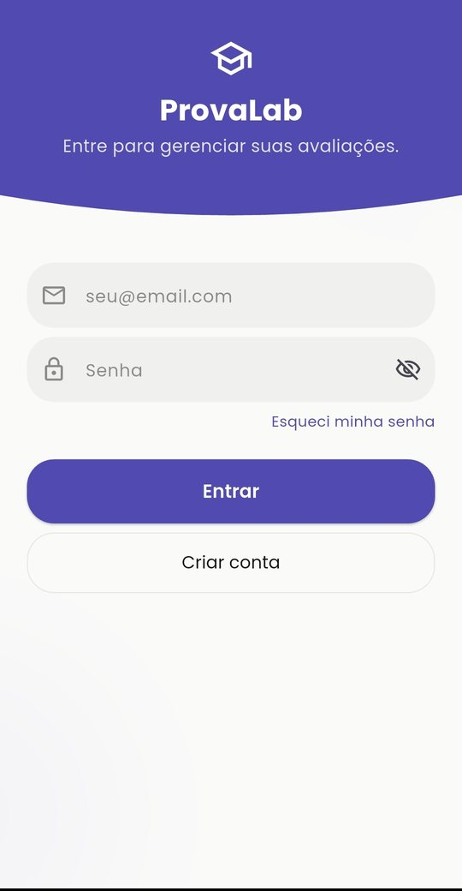
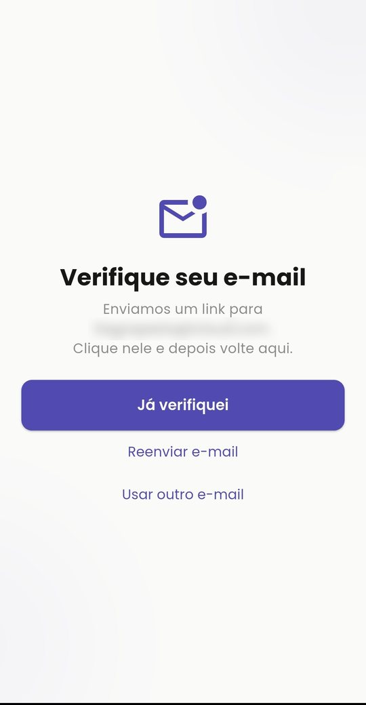
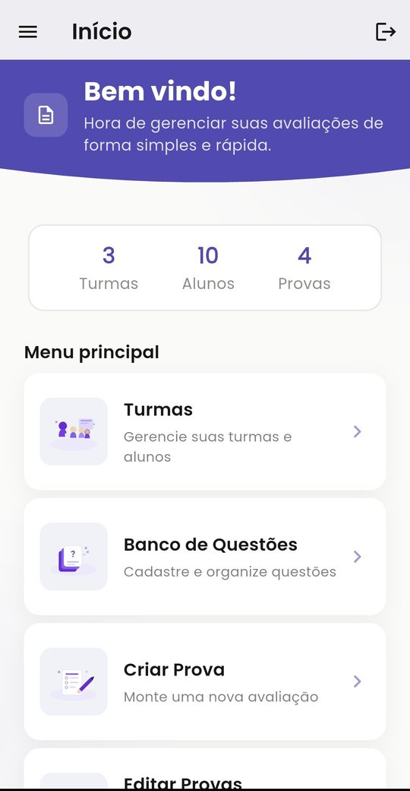
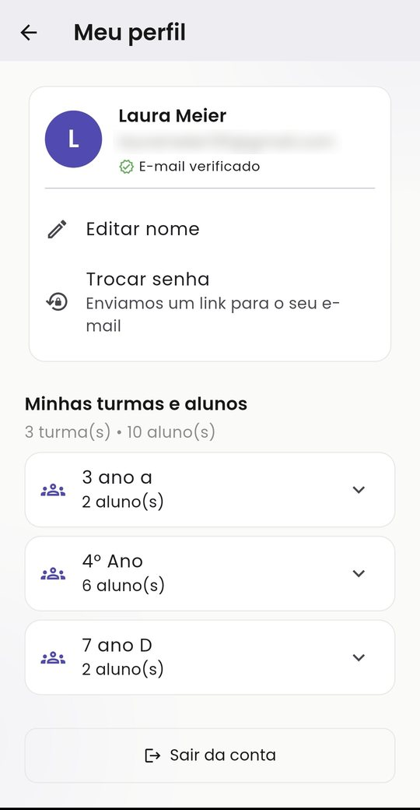

# Manual do usuário: Primeiros passos: conta, login e tela inicial

> Módulo de **Laura Meier** · [voltar ao índice do manual](README.md)

Este módulo é a porta de entrada do app. Aqui você cria a sua conta de professor, confirma o seu e-mail, entra no app e chega à tela **Início**, que mostra os totais de turmas, alunos e provas e dá acesso a todas as outras partes do app. No **Meu perfil** você confere os seus dados, muda o seu nome, pede uma nova senha e sai da conta.

Cada professor tem a **sua própria conta**: as turmas, os alunos, as questões e as provas que você cadastra ficam ligados a ela.

**Antes de começar, você precisa:**
- ter o app instalado no celular;
- ter um e-mail que você consiga abrir (o app manda um link de confirmação para ele);
- estar com internet.

---

## 1. Criar a conta de professor

Ao abrir o app pela primeira vez, aparece a tela de entrada do **ProvaLab**. Toque em **Criar conta**.

Na tela **Criar conta**, preencha:

1. **Seu nome**: o nome que vai aparecer no app.
2. **seu@email.com**: o seu e-mail.
3. **Senha (mínimo 6 caracteres)**.
4. **Confirmar senha**: digite a mesma senha de novo.
5. Toque em **Cadastrar**.

> Toque no ícone de olho dentro do campo de senha para mostrar ou esconder o que você digitou.

Se você já tem conta, toque em **Já tenho conta** (ou na seta no topo) para voltar à tela de entrada.

O app confere os dados antes de criar a conta:

| Mensagem | O que significa |
|---|---|
| *"Preencha todos os campos."* | Algum campo ficou vazio. |
| *"Digite um e-mail válido."* | O e-mail está incompleto ou com erro de digitação. |
| *"A senha precisa ter pelo menos 6 caracteres."* | A senha é curta demais. |
| *"As senhas não coincidem."* | A senha e a confirmação estão diferentes. |
| *"Este e-mail já está cadastrado."* | Já existe uma conta com esse e-mail. Volte e toque em **Entrar**, ou use **Esqueci minha senha**. |

---

## 2. Confirmar o e-mail

Logo depois do cadastro, o app envia um link de confirmação para o seu e-mail e mostra a tela **Verifique seu e-mail**. **O app só libera o acesso depois que o e-mail é confirmado.**

1. Abra a sua caixa de entrada e procure o e-mail de confirmação.
2. Toque no link que veio no e-mail.
3. Volte ao app e toque em **Já verifiquei**.
4. Pronto: o app abre a tela **Início**.

Nesta tela também há:
- **Reenviar e-mail**: manda o link de novo. Aparece a mensagem *"E-mail reenviado. Confira também o spam."*
- **Usar outro e-mail**: volta para a tela de entrada, para você entrar ou criar a conta com outro e-mail.

> Se você tocar em **Já verifiquei** antes de clicar no link, aparece *"Ainda não verificado. Clique no link enviado ao seu e-mail."*

Se você fechar o app antes de confirmar, não tem problema: na próxima vez que tentar entrar, o app mostra de novo a tela **Verifique seu e-mail**.

---

## 3. Entrar no app

Na tela de entrada:

1. Digite o seu e-mail no campo **seu@email.com**.
2. Digite a sua **Senha**.
3. Toque em **Entrar**.

Se o e-mail ainda não foi confirmado, o app leva você para a tela **Verifique seu e-mail** (veja o passo 2). Se já foi, abre a tela **Início**.

---

## 4. Esqueci minha senha

1. Na tela de entrada, digite o seu e-mail no campo **seu@email.com**.
2. Toque em **Esqueci minha senha**, logo abaixo do campo de senha.
3. Aparece a mensagem *"Enviamos um link de recuperação para o seu e-mail."*
4. Abra o e-mail, toque no link e crie uma nova senha.
5. Volte ao app e entre com a senha nova.

> Se o campo de e-mail estiver vazio, o app avisa: *"Digite seu e-mail para recuperar a senha."*

---

## 5. A tela inicial

Depois de entrar, abre a tela **Início**, com a mensagem **"Bem vindo!"**.

### Totais de turmas, alunos e provas

No quadro logo abaixo da mensagem de boas-vindas aparecem três números:

- **Turmas**: quantas turmas você cadastrou;
- **Alunos**: quantos alunos há somando todas as suas turmas;
- **Provas**: quantas provas você criou.

Os números se atualizam sozinhos: ao cadastrar uma turma, um aluno ou uma prova, o total muda na hora, sem precisar recarregar. Enquanto o app ainda está carregando, aparece um traço (**-**) no lugar do número.

### Menu principal

Abaixo dos totais fica o **Menu principal**. Toque em um cartão para abrir a parte do app:

| Cartão | Para que serve |
|---|---|
| **Turmas** | Gerencie suas turmas e alunos |
| **Banco de Questões** | Cadastre e organize questões |
| **Criar Prova** | Monte uma nova avaliação |
| **Editar Provas** | Visualize, edite e exclua provas |
| **Corrigir Prova** | Correção automatizada das provas |
| **Relatórios** | Acompanhe os resultados |

---

## 6. O menu de navegação

Toque no ícone **☰**, no canto superior esquerdo da tela **Início**, para abrir o menu lateral. Em telas grandes (tablet ou computador), o menu já fica aberto à esquerda.

No menu estão:
- **Início**, **Turmas**, **Banco de Questões**, **Criar Prova**, **Editar Provas**, **Corrigir Prova** e **Relatórios**: os mesmos caminhos do Menu principal;
- no final, o **seu nome** (ou **Meu perfil**, se a conta estiver sem nome): abre o seu perfil;
- **Sair da conta**, em vermelho.

---

## 7. Meu perfil

Abra o menu lateral e toque no **seu nome**, no final da lista. Abre a tela **Meu perfil**.

No topo aparecem o seu nome, o seu e-mail e a situação do e-mail (**E-mail verificado**).

- **Editar nome:** toque, digite o novo nome no campo **Nome** e toque em **Salvar** (ou **Cancelar** para desistir). Aparece *"Nome atualizado."*
- **Trocar senha:** toque e o app envia para o seu e-mail um link para criar uma nova senha. Aparece *"Enviamos um link para (seu e-mail) para você criar uma nova senha."*

### Minhas turmas e alunos

Mais abaixo, o perfil mostra quantas turmas e alunos você tem (por exemplo, *"3 turma(s) • 10 aluno(s)"*) e a lista das suas turmas, cada uma com a quantidade de alunos.

- Toque em uma turma para ver os alunos dela, com o nome e a **Matrícula** de cada um.
- Se ainda não há turmas, aparece *"Você ainda não cadastrou nenhuma turma."*
- Se a turma não tem alunos, aparece *"Nenhum aluno nesta turma."*

Esta lista é só para consulta. Para cadastrar ou alterar turmas e alunos, use **Turmas** (veja a seção [Turmas e Alunos](turmas-e-alunos.md)).

---

## 8. Sair da conta

Você pode sair de três lugares:

- na tela **Início**, pelo ícone de saída no canto superior direito;
- no menu lateral, em **Sair da conta**;
- no **Meu perfil**, pelo botão **Sair da conta**, no final da tela.

O app volta para a tela de entrada. Para usar de novo, é só entrar com o seu e-mail e a sua senha.

---

## Problemas comuns

| Mensagem ou situação | O que fazer |
|---|---|
| *"Preencha e-mail e senha."* | Digite o e-mail e a senha antes de tocar em **Entrar**. |
| *"E-mail ou senha incorretos."* | Confira o que foi digitado. Se esqueceu a senha, use **Esqueci minha senha**. |
| *"E-mail inválido."* | O e-mail digitado está com erro. Confira e tente de novo. |
| *"Este e-mail já está cadastrado."* | Você já tem conta com esse e-mail. Toque em **Entrar** em vez de **Criar conta**. |
| *"A senha precisa ter pelo menos 6 caracteres."* | Escolha uma senha com 6 ou mais caracteres. |
| *"As senhas não coincidem."* | Digite a mesma senha nos dois campos do cadastro. |
| *"Ainda não verificado. Clique no link enviado ao seu e-mail."* | Abra o e-mail de confirmação, toque no link e só depois toque em **Já verifiquei**. |
| O e-mail de confirmação ou de nova senha não chegou | Confira a pasta de spam. Na tela **Verifique seu e-mail**, toque em **Reenviar e-mail**. |
| *"Muitas tentativas. Tente novamente mais tarde."* ou *"...Aguarde um pouco e tente de novo."* | Foram feitas muitas tentativas seguidas. Espere alguns minutos e tente de novo. |
| *"Sem conexão com a internet."* | Conecte o celular à internet e tente de novo. |
| *"Não foi possível carregar seu perfil."* | Toque em **Sair**, confira a internet e entre de novo. |
| Os totais da tela inicial mostram **-** | O app ainda está carregando. Aguarde alguns segundos com a internet ligada. |
