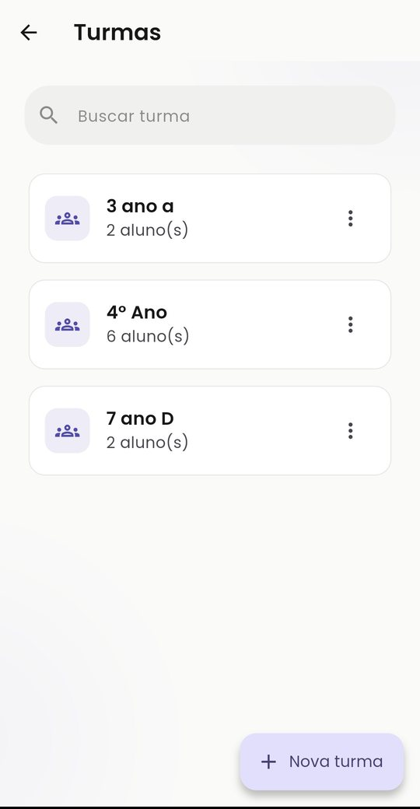
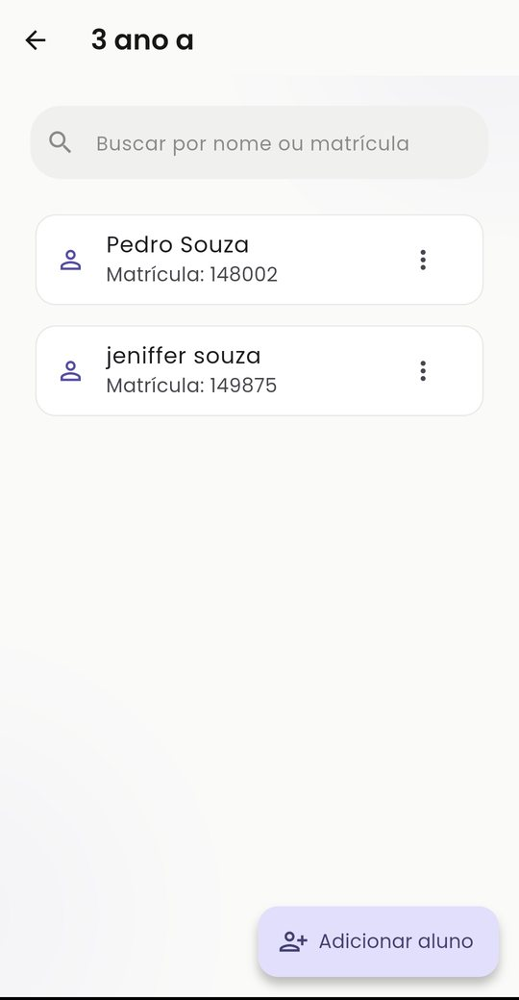

# Manual do usuário: Turmas e Alunos

> Módulo de **Nicolas Renan Dellani** · [voltar ao índice do manual](README.md)

Este módulo guarda as suas turmas e os alunos de cada uma. Para cada aluno você cadastra o **nome** e a **matrícula**. São essas turmas e esses alunos que o app usa depois para gerar uma prova para cada aluno, corrigir as folhas de respostas e montar os relatórios.

Cada professor tem as **suas próprias turmas**: o que você cadastra fica ligado à sua conta e não aparece para outros professores.

**Antes de começar, você precisa:**
- estar logado no app (veja a seção [Primeiros passos](primeiros-passos.md));
- estar com internet para salvar as alterações.

---

## 1. Abrir as turmas

Na tela inicial, toque em **Turmas** (também dá para abrir pelo menu lateral).

Cada turma aparece em um cartão com o **nome** e a quantidade de alunos (por exemplo, *"2 aluno(s)"*). A lista se atualiza sozinha: qualquer turma criada, editada ou excluída aparece na hora.

Se você ainda não tem turmas, a tela mostra *"Nenhuma turma cadastrada ainda."*

---

## 2. Criar uma turma

1. Na tela **Turmas**, toque em **Nova turma**, no canto inferior direito.
2. Na tela **Cadastrar turma**, digite o **Nome da turma** (por exemplo, *"3º Ano C - ADS"*).
3. Toque em **Salvar**.

A turma aparece na lista com *"0 aluno(s)"*.

---

## 3. Editar o nome de uma turma

1. Na lista de turmas, toque nos **três pontinhos** ao lado da turma.
2. Escolha **Editar**.
3. Na tela **Editar turma**, altere o **Nome da turma**.
4. Toque em **Salvar alterações**.

---

## 4. Excluir uma turma

1. Na lista de turmas, toque nos **três pontinhos** ao lado da turma.
2. Escolha **Excluir**.
3. O app pergunta: *"Tem certeza que deseja excluir "(nome da turma)" e todos os seus alunos?"*
4. Toque em **Excluir** para confirmar ou em **Cancelar** para desistir.

> **Atenção:** ao excluir uma turma, **todos os alunos dela também são excluídos**. Não há como desfazer.

---

## 5. Abrir uma turma

Na lista de turmas, toque no **nome da turma**. Abre a tela da turma, com o nome dela no topo e a lista de alunos.

Cada aluno aparece com o **nome** e a **Matrícula**. A lista se atualiza sozinha a cada aluno adicionado, editado ou excluído.

Se a turma ainda não tem alunos, aparece *"Nenhum aluno cadastrado nesta turma ainda."*

---

## 6. Adicionar um aluno

1. Dentro da turma, toque em **Adicionar aluno**, no canto inferior direito.
2. Na tela **Cadastrar aluno**, preencha:
   - **Nome do aluno**;
   - **Matrícula**.
3. Toque em **Salvar**.

O aluno aparece na lista da turma e a quantidade de alunos da turma aumenta.

---

## 7. Editar ou excluir um aluno

### Editar

1. Dentro da turma, toque nos **três pontinhos** ao lado do aluno.
2. Escolha **Editar**.
3. Na tela **Editar aluno**, altere o **Nome do aluno** e/ou a **Matrícula**.
4. Toque em **Salvar alterações**.

### Excluir

1. Toque nos **três pontinhos** ao lado do aluno.
2. Escolha **Excluir**.
3. O app pergunta: *"Tem certeza que deseja excluir "(nome do aluno)" desta turma?"*
4. Toque em **Excluir** para confirmar ou em **Cancelar** para desistir.

O aluno sai da lista e a quantidade de alunos da turma diminui.

---

## 8. Buscar turmas e alunos

As duas listas têm um campo de busca no topo. Ele aparece quando há pelo menos uma turma ou um aluno cadastrado.

- Na tela **Turmas**, use **Buscar turma** para procurar pelo nome da turma.
- Dentro de uma turma, use **Buscar por nome ou matrícula** para procurar o aluno pelo nome **ou** pela matrícula.

A lista vai filtrando enquanto você digita. A busca **não diferencia acentos nem maiúsculas**: digitar *"joao"* encontra *"João da Silva"*. Também encontra pedaços do texto: digitar *"148"* encontra a matrícula *"148002"*.

Para voltar a ver a lista inteira, apague o texto ou toque no **X** dentro do campo (**Limpar busca**).

Se nada for encontrado, aparece *"Nenhuma turma encontrada."* ou *"Nenhum aluno encontrado."*

---

## 9. Regras de preenchimento

O app confere os campos ao tocar em **Salvar**. Quando algo está errado, a mensagem aparece **embaixo do campo**, em vermelho, e nada é salvo. Corrija o campo e toque em **Salvar** de novo.

### Espaços extras

Você não precisa se preocupar com espaços sobrando:
- no **nome da turma** e no **nome do aluno**, o app tira os espaços do começo e do fim e troca vários espaços seguidos por um só. Por exemplo, *"  3º  Ano   A "* é salvo como *"3º Ano A"*;
- na **matrícula**, o app tira os espaços do começo e do fim. Já um espaço **no meio** da matrícula não é aceito.

### Nome da turma

| Mensagem | O que significa |
|---|---|
| *"Informe o nome da turma."* | O campo ficou vazio. |
| *"O nome precisa ter ao menos 3 caracteres."* | O nome é curto demais. |
| *"O nome pode ter no máximo 60 caracteres."* | O nome é longo demais. |
| *"Já existe uma turma com esse nome."* | Você já tem outra turma com esse nome. |

**Nome de turma repetido:** para o app, *"3º Ano A"*, *"3º ano a"* e *"3º  Ano  A"* são o **mesmo nome**, porque ele não diferencia maiúsculas, acentos nem espaços extras. Escolha um nome diferente, por exemplo acrescentando o turno ou o curso.

### Nome do aluno

| Mensagem | O que significa |
|---|---|
| *"Informe o nome do aluno."* | O campo ficou vazio. |
| *"O nome precisa ter ao menos 3 caracteres."* | O nome é curto demais. |
| *"O nome pode ter no máximo 80 caracteres."* | O nome é longo demais. |
| *"O nome não pode ter números."* | Há algum número no nome. |

### Matrícula

| Mensagem | O que significa |
|---|---|
| *"Informe a matrícula."* | O campo ficou vazio. |
| *"A matrícula não pode ter espaços."* | Há um espaço no meio da matrícula. |
| *"Use só letras, números, ponto, hífen ou sublinhado."* | A matrícula tem algum símbolo que não é aceito (como `/`, `#` ou letra com acento). |
| *"A matrícula precisa ter ao menos 3 caracteres."* | A matrícula é curta demais. |
| *"A matrícula pode ter no máximo 20 caracteres."* | A matrícula é longa demais. |
| *"Já existe um aluno com essa matrícula nesta turma."* | Outro aluno **desta mesma turma** já usa essa matrícula. |

**Matrícula repetida:** a regra vale **dentro da turma**. Dois alunos da mesma turma não podem ter a mesma matrícula (o app não diferencia maiúsculas: *"ab123"* e *"AB123"* contam como iguais). Em turmas diferentes, a mesma matrícula pode ser usada.

---

## Problemas comuns

| Mensagem ou situação | O que fazer |
|---|---|
| *"Já existe uma turma com esse nome."* | Use um nome diferente. Lembre que maiúsculas, acentos e espaços extras não contam como diferença. |
| *"Já existe um aluno com essa matrícula nesta turma."* | Confira a matrícula. Se o aluno já está na turma, edite o cadastro dele em vez de criar outro. |
| *"Sem conexão com o servidor. A alteração será enviada quando a internet voltar."* | Você está sem internet. A tela fecha e a alteração é enviada sozinha quando a conexão voltar. Não cadastre de novo. |
| *"Sem conexão com o servidor. Verifique sua internet e tente novamente."* | Conecte o celular à internet e tente de novo. |
| *"Esse item não existe mais (talvez já tenha sido excluído)."* | A turma ou o aluno já foi excluído. Volte para a lista, que mostra a situação atual. |
| *"Faça login para salvar alterações."* | Saia e entre de novo na sua conta. |
| Excluí uma turma por engano | Não há como desfazer. Cadastre a turma e os alunos de novo. |
| A busca não encontra nada | Confira o texto digitado ou toque no **X** do campo para ver a lista inteira. |
